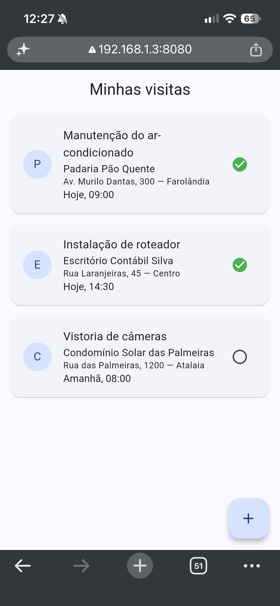

# Checkpoint

App de registro de visitas técnicas em campo. Projeto integrador da
disciplina Desenvolvimento Mobile — UNIT 2026, Prof. Petros Barreto.

**Aluno(a):** Arthur David Cardoso de Souza Luna

## Diário de construção

| Lab | O que entrou                                           |
| --- | ------------------------------------------------------ |
| 01  | Projeto criado com `flutter create`; nome e cor do app |

| 02 | Ambiente completo; app rodando no Android; nome no launcher; analyze e test verdes |

## Aparelho de testes

| Item   | Valor                |
| ------ | -------------------- |
| Modelo | (preencha no Lab 04) |

| 03 | Template removido; `app.dart`, `VisitasPage` e `VisitaCard`; botão de concluída com `setState` |
